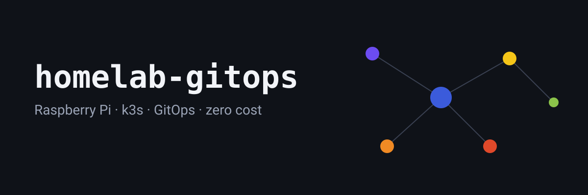
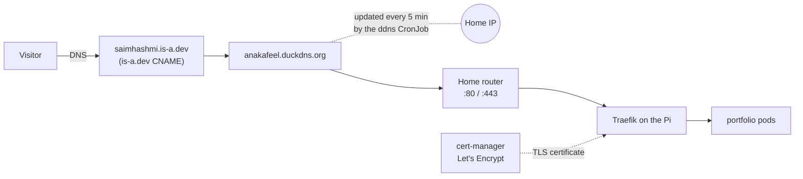
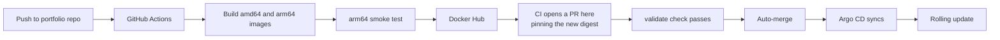
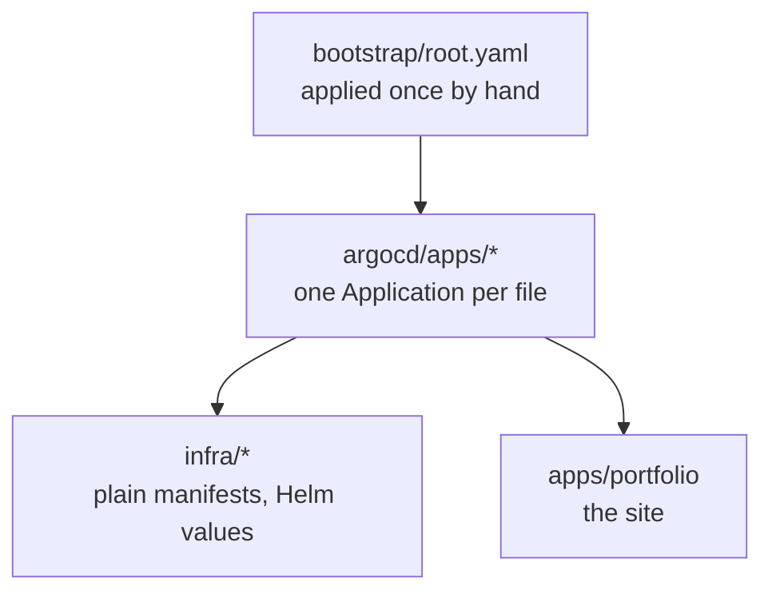
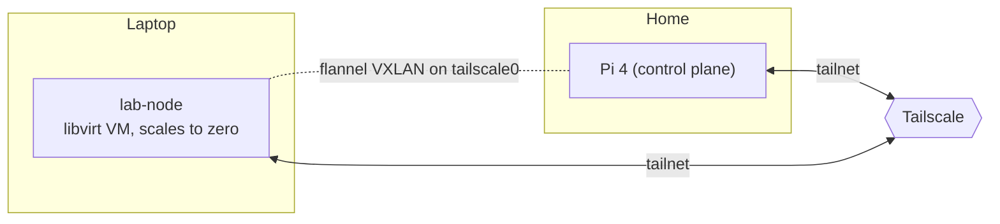

# homelab-gitops



This repo runs a home server on a Raspberry Pi 4 (8 GB, arm64). The Pi started
with Docker Compose. It now runs k3s, and everything on it is deployed from
git with Argo CD. The rule for the whole lab is zero cost: only free,
open-source, self-hosted tools. The public site, [saimhashmi.is-a.dev](https://saimhashmi.is-a.dev),
is served from this cluster.

Explore the homelab as an interactive graph → [saimhashmi.is-a.dev/#homelab](https://saimhashmi.is-a.dev/#homelab)

## How it all fits

### Request path

A visitor's browser reaches the portfolio through a chain of free services.



is-a.dev points to a DuckDNS name. DuckDNS points to the home IP. The router
forwards ports 80 and 443 to Traefik. cert-manager gets a Let's Encrypt
certificate for the site through an HTTP-01 challenge.

### Deploy pipeline

A change to the site ships without anyone running a deploy command.



The portfolio repo builds both architectures on native runners. The arm64
image must serve pages before it is pushed. Then CI pins the image digest in
a PR here. The PR merges once `validate` passes, and Argo CD rolls it out.

### GitOps layout

Argo CD uses an app-of-apps setup. One root app reads a folder of child apps.



`bootstrap/root.yaml` is the only manifest applied by hand. It points at
`argocd/apps/`. Each file there creates one Argo CD app. Those apps point at
folders under `infra/` or `apps/`. After the first apply, every change goes
through git. Auto-sync with prune and self-heal is on for every app.

### Nodes



The Pi runs the control plane. `lab-node` is a VM on a laptop. OpenTofu and
libvirt create it. A small script starts it when a pod needs it and stops it
after 15 idle minutes. The VM joins the cluster over Tailscale, and flannel
runs on the `tailscale0` interface.

## What runs here

| App | Why it is here |
|---|---|
| Argo CD | It keeps the cluster in sync with this repo, so git is the only source of truth. |
| kube-prometheus-stack | Prometheus, Grafana and Alertmanager show what the Pi is doing and send alerts. Sized small for the Pi. |
| Alertmanager to Discord | Alerts land in a Discord channel. Resolved alerts go there too. |
| Dead man's switch (healthchecks.io) | A watchdog ping goes out every minute. If the Pi or its monitoring stops, the pings stop and healthchecks.io alerts from outside. |
| blackbox-exporter | It checks the public site from inside the cluster, so the site is probed end to end: DNS, router, Traefik, pods. |
| cert-manager | It renews the Let's Encrypt certificates, so the site does not need manual renewals. |
| ddns (CronJob) | It keeps the DuckDNS name on the home IP. A new ISP address heals itself within 5 minutes. |
| Garage | A self-hosted S3 API. It holds the OpenTofu state, so state does not need a paid service. |
| Tailscale operator | It exposes admin UIs only on the tailnet. Argo CD and Grafana are not on the public internet. |
| portfolio | The site itself: two replicas, read-only root filesystem, non-root user. |

The `monitoring` app also holds the alert rules (site down, TLS expiry, disk
space) and the Grafana dashboard. The `argocd-ingress`, `tailscale-oauth` and
`cert-manager-issuers` apps are small glue for the apps above.

## Security and guardrails

- **Secrets in a public repo.** Secrets are encrypted with SOPS and age.
  KSOPS decrypts them inside Argo CD. Plain `Secret` manifests are rejected by
  CI, so a secret cannot be committed by accident.
- **Branch protection.** Changes to `main` need the `validate` check to pass.
  It runs kubeconform (strict schema checks), kube-linter, `tofu fmt` and
  `tofu validate`, tflint, and a trivy config scan. Every tool is downloaded
  as a pinned binary and checked with a SHA-256 hash.
- **Updates through PRs.** Renovate opens update PRs. Nothing merges
  automatically except the portfolio image pin, and that PR still needs
  `validate`.
- **Admin UIs on the tailnet only.** Argo CD, Grafana and the Garage admin
  API are not on the public internet.
- **Public edge is small.** Only ports 80 and 443 are forwarded from the
  router, and only to Traefik.

## Repo layout

```
bootstrap/     the one manifest applied by hand (the root Argo CD app)
argocd/apps/   one Argo CD Application per file (the children of root)
apps/          the portfolio app (Deployment, Service, Ingresses)
infra/         platform pieces: monitoring, garage, cert-manager, ddns, tailscale, argocd-ingress
tofu/          OpenTofu stacks: bootstrap (Garage state bucket) and laptop-vms (lab-node)
.github/       the validate workflow
```

Each `tofu/` stack has its own README with setup steps.

## Lessons learned

These come from the repo history and from the portfolio repo.

- **Node on alpine segfaulted on the Pi.** Every musl (alpine) Node 22 process
  crashed in ICU when it formatted a date, which Node does on every HTTP
  response. The portfolio image moved to `node:22-slim`. (portfolio repo,
  `e207c2a`)
- **A VM that reboot-looped.** The laptop VM had no video device, so the
  Debian kernel reset after GRUB every time. Adding a VGA device fixed the
  boot. (`7666709`)
- **Tools are pinned binaries, not actions.** The trivy GitHub Action had a
  tag hijacked in a supply-chain attack, so the validate job downloads tool
  binaries and checks their hashes instead. (`200459b`)
- **Cloudflare Tunnel cannot serve is-a.dev names.** The zone lives in
  is-a.dev's own Cloudflare account, so the tunnel could not route the name.
  The site moved to a direct path: DuckDNS, port forwarding and Traefik. The
  tunnel was removed later. (`d5f91b9`, `06e1ff7`)
- **Garage refused its own secret files.** Garage wants mode 0600, but
  Kubernetes mounts secrets as root with group read. The fix skips Garage's
  strict check, and the files stay 0440, never world-readable. (`1270fd8`)
- **A stopped VM left a NotReady node.** Every scale-down paged. The
  autoscaler now deletes the node when it stops the VM, and the agent
  re-registers on the next boot. (`5746035`)

## Links

- Live site: [saimhashmi.is-a.dev](https://saimhashmi.is-a.dev)
- Portfolio repo (the app and its CI): [anakafeel/portfolio-website](https://github.com/anakafeel/portfolio-website)
- Interactive homelab graph: [saimhashmi.is-a.dev/#homelab](https://saimhashmi.is-a.dev/#homelab), in the "Homelab" section of the home page
